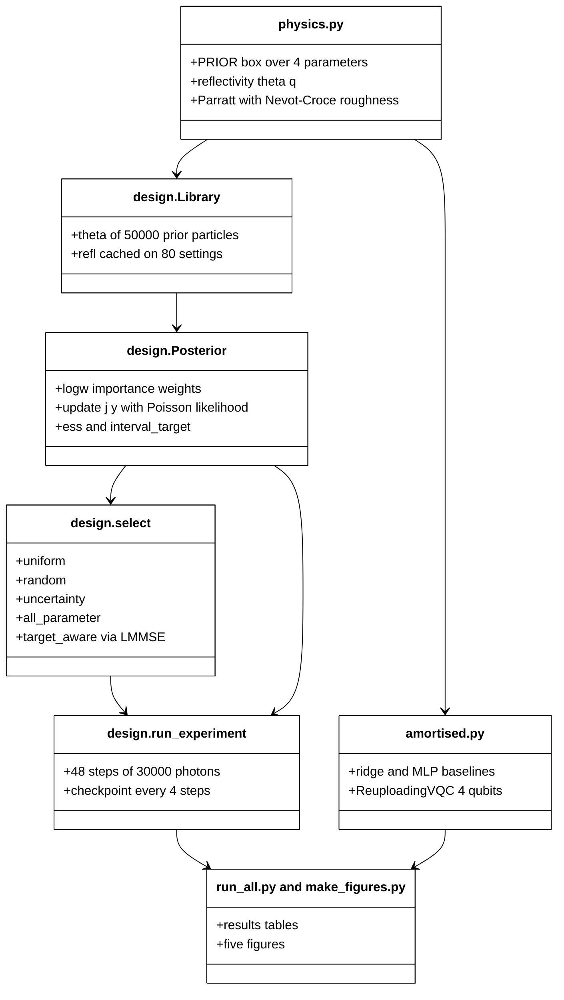
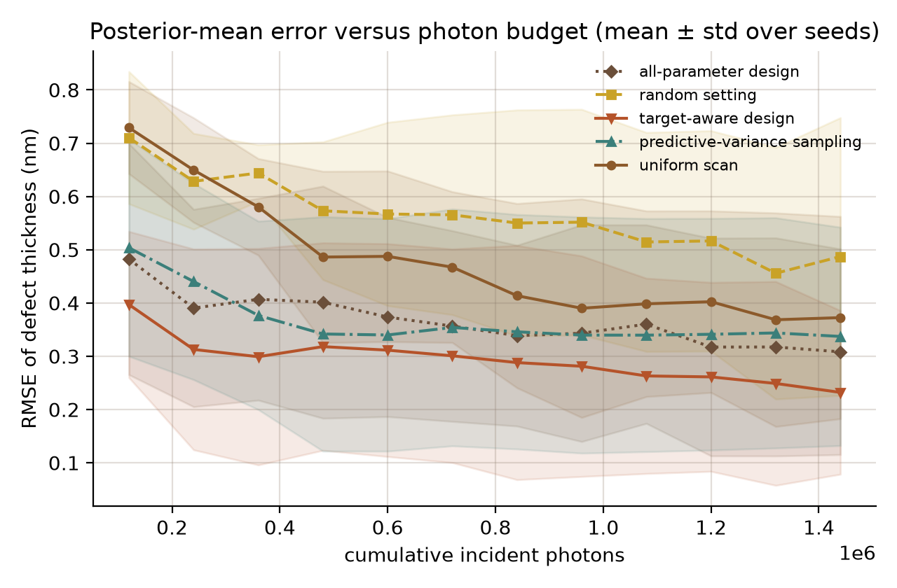
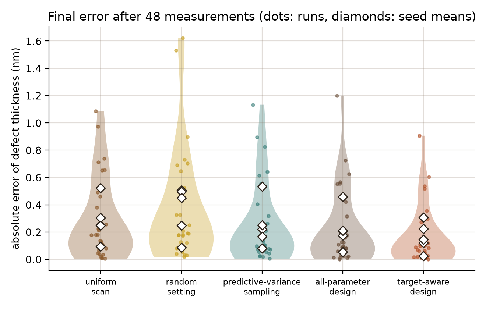
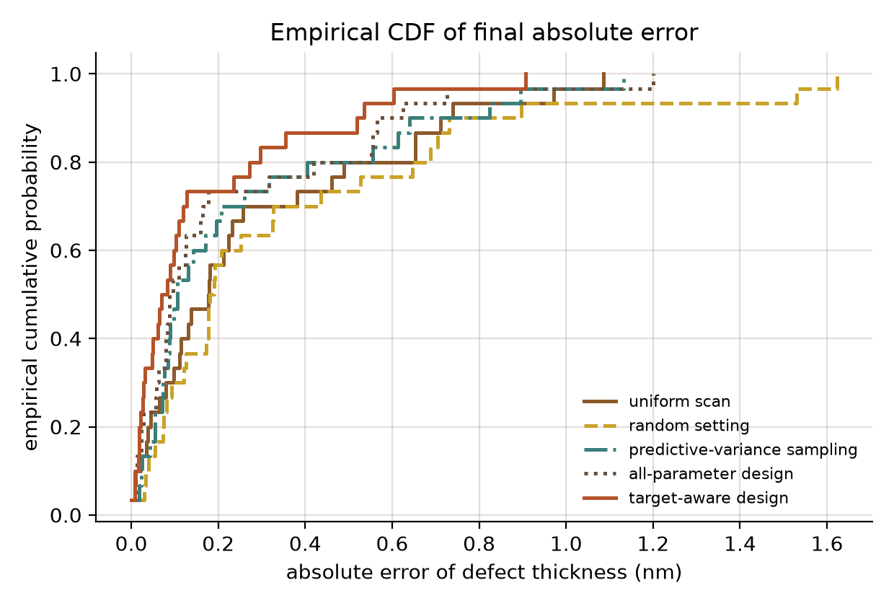
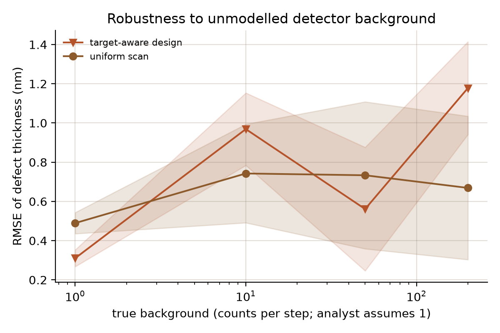
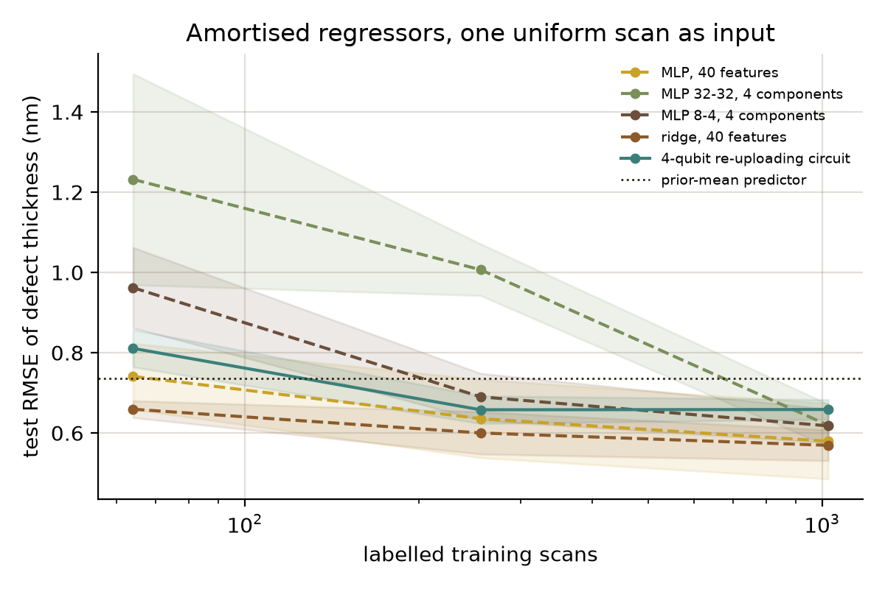

# Target-Aware Sequential Design of X-ray Reflectivity Measurements for Buried Interface Defect Layers

[](LICENSE)
[](pyproject.toml)
[](.github/workflows/ci.yml)

## Abstract

Defects in buried layers between a superconducting film and its substrate are a candidate source of loss in quantum devices, and X-ray reflectivity (XRR) can probe them, but every measurement setting costs photons. This simulation study compares five rules for choosing the next XRR setting (uniform scan, random, predictive-variance sampling, an all-parameter design and a target-aware design) at equal photon budget on a physics-based Parratt forward model with a Bayesian posterior, and tests classical and 4-qubit quantum amortised regressors as surrogates. The target-aware design lowers the root-mean-square error (RMSE) of the defect-layer thickness to 0.560 ± 0.220 times that of the uniform scan (5 of 5 seeds), but this advantage disappears when the detector background is unmodelled, and the quantum regressor does not beat the best classical one. All data are simulated with illustrative optical constants; no beamline data and no quantum advantage are claimed.

## Hypotheses

All three are stated before the runs and are falsifiable (details in `docs/RESEARCH_GAP.md`).

- **H1.** At equal photon budget (48 steps of 3 x 10^4 photons) a target-aware sequential design lowers the thickness RMSE by at least 20 % relative to a uniform scan.
- **H2.** The advantage persists when the true detector background is up to 200 times the value assumed by the analyst.
- **H3.** With 64 to 1024 labelled simulated scans, a 4-qubit data re-uploading variational quantum circuit (VQC) reaches a lower test RMSE than classical regressors on the same inputs.

## Motivation

Two-level-system (TLS) defects at buried oxide and contamination interfaces are widely suspected to limit superconducting qubit coherence, and synchrotron XRR is a non-destructive probe of such layers. Beam time is limited, so a characterisation platform has to answer two questions: which physical model explains the curve, and which setting should be measured next. This repository studies the second question in a controlled simulation where the answer can be scored against known ground truth.

## Research gap

The supplied literature does not cover X-ray characterisation or experiment design, so the gap is derived from where its device, theory and quantum machine learning (ML) strands meet (full related-work table with 12 papers in `docs/RESEARCH_GAP.md`).

- Device papers reach very low error: two-qubit gates with 99.5 % fidelity on up to 60 atoms (Evered et al., 2023, doi:10.1038/s41586-023-06481-y), error-corrected superconducting memory beyond break-even with a coherence gain of 2.27 ± 0.07 obtained with model-free reinforcement learning (Sivak et al., 2023, doi:10.1038/s41586-023-05782-6), and a review of how noise limits spin qubits (Burkard et al., 2023, doi:10.1103/RevModPhys.95.025003).
- Theory papers supply first-principles forward models of anisotropic interactions and magnon-phonon coupling (Suaud et al., 2026, doi:10.1016/j.ccr.2026.218440; Wang et al., 2027, doi:10.15302/frontphys.2027.025202).
- The standard quantum ML baseline is the data re-uploading circuit viewed as a linear quantum model (Jerbi et al., 2023, doi:10.1038/s41467-023-36159-y).

None of these chooses the next structural measurement under a photon budget, and none tests whether a quantum surrogate can replace a physics model when labelled simulations are scarce. The brief labels all records with the generic role "other", so the roles in the related-work table are assigned by the repository author.

## What is new here

- A reproducible, photon-budgeted comparison of five measurement-selection rules for a buried defect layer, with a paired-by-seed error metric and an ablation that separates target-aware from all-parameter design.
- A robustness test against unmodelled detector background that shows where the design advantage fails, not only where it holds.
- A 4-qubit re-uploading circuit, checked against PennyLane, evaluated against classical regressors on the same physics-generated task, with shot-noise and depth ablations.

## Method



Legend: LMMSE, linear minimum-mean-square-error estimator; MLP, multilayer perceptron; VQC, variational quantum circuit; ESS, effective sample size.

**Forward model.** A Parratt recursion with Nevot-Croce roughness gives the specular reflectivity of vacuum / niobium-oxide cap / niobium film / buried defect layer / sapphire. The unknowns are the defect thickness (target, 0.5 to 3.0 nm), its density fraction, its interface roughness and the film thickness. Optical constants are generic electron-density estimates at 8.05 keV, not fitted values.

**Measurement and inference.** Each step spends 3 x 10^4 photons at one of 80 momentum-transfer settings and records a Poisson count. The posterior is an importance-weighted library of 50 000 prior particles with cached curves.

**Selection rules.** Uniform scan (classical baseline, space-filling order), random, predictive-variance sampling (active-learning baseline), all-parameter design (ablation) and target-aware design (proposed). The last two maximise the expected variance reduction of an LMMSE estimate from one Poisson count; the target-aware rule scores only the defect thickness.

**Amortised regressors.** Ridge and MLPs (classical) against a 2-layer, 4-qubit data re-uploading VQC (quantum baseline), all mapping one 40-point uniform scan to the thickness. Full protocol: `docs/METHOD.md`.

## Results

All numbers below are read from `results/summary.json`, `results/photon_saving.json` and `results/robust_paired_ratio.json`. Values after ± are standard deviations over seeds.

### Experiment 1: equal-photon comparison (5 seeds x 6 truths, 48 steps, 1.44 x 10^6 photons)

| Method | Final RMSE (nm) | RMSE ratio to uniform (paired) | Seeds better than uniform | 90 % interval width (nm) | 90 % interval coverage | Screening accuracy at 1.5 nm | Median ESS |
|---|---|---|---|---|---|---|---|
| Uniform scan | 0.372 ± 0.190 | 1 | n/a | 1.090 | 0.833 | 0.867 | 343 |
| Random setting | 0.487 ± 0.261 | 1.342 ± 0.652 | 3 of 5 | 1.187 | 0.833 | 0.833 | 625 |
| Predictive-variance sampling | 0.337 ± 0.205 | 0.866 ± 0.180 | 4 of 5 | 1.043 | 0.867 | 0.900 | 282 |
| All-parameter design | 0.308 ± 0.193 | 0.773 ± 0.207 | 5 of 5 | 0.816 | 0.900 | 0.933 | 193 |
| **Target-aware design** | **0.232 ± 0.154** | **0.560 ± 0.220** | **5 of 5** | **0.770** | 0.833 | **0.933** | 274 |



*Figure 1. The target-aware design is below every other rule at every checkpoint and drops under the uniform scan's final error (0.372 nm) at 2.4 x 10^5 photons, against 1.44 x 10^6 photons for the uniform scan itself (checkpoints are 4 steps apart).*



*Figure 2. Per-run final errors overlap strongly between methods; the target-aware design mainly removes the large-error tail.*



*Figure 3. The empirical distribution of final absolute error for the target-aware design lies above those of the uniform and random rules over most of the range.*

### Experiment 2: unmodelled detector background (3 seeds x 4 truths, analyst assumes 1 count per step)

| True background (counts per step) | Uniform RMSE (nm) | Target-aware RMSE (nm) | Paired ratio | Seeds better | Coverage uniform / target-aware |
|---|---|---|---|---|---|
| 1 (matched) | 0.489 ± 0.054 | 0.310 ± 0.043 | 0.640 ± 0.127 | 3 of 3 | 0.917 / 0.833 |
| 10 | 0.743 ± 0.251 | 0.969 ± 0.185 | 1.435 ± 0.685 | 0 of 3 | 0.000 / 0.250 |
| 50 | 0.733 ± 0.375 | 0.561 ± 0.315 | 1.013 ± 0.731 | 1 of 3 | 0.083 / 0.167 |
| 200 | 0.669 ± 0.366 | 1.178 ± 0.237 | 2.268 ± 1.475 | 1 of 3 | 0.000 / 0.000 |



*Figure 4. Once the background is unmodelled, both rules lose their interval calibration and the target-aware design is no longer reliably better than the uniform scan.*

### Experiment 3: amortised regressors (3 seeds, 400 test scans; the mean-of-training-labels predictor has RMSE 0.735 nm)

| Training scans | Ridge, 40 features | MLP, 40 features | MLP 8-4, 4 components | MLP 32-32, 4 components | 4-qubit VQC |
|---|---|---|---|---|---|
| 64 | 0.659 ± 0.021 | 0.741 ± 0.082 | 0.962 ± 0.100 | 1.232 ± 0.263 | 0.811 ± 0.046 |
| 256 | 0.600 ± 0.053 | 0.636 ± 0.098 | 0.690 ± 0.058 | 1.007 ± 0.064 | 0.658 ± 0.034 |
| 1024 | 0.569 ± 0.038 | 0.580 ± 0.094 | 0.618 ± 0.042 | 0.619 ± 0.053 | 0.659 ± 0.025 |

VQC ablations at 1024 training scans: a single layer gives 0.687 ± 0.024 nm (two layers: 0.659 ± 0.025); finite-shot read-out gives 0.660 ± 0.025 nm at 1000 shots and 0.672 ± 0.032 nm at 100 shots.



*Figure 5. All amortised regressors stay close to the label-mean predictor; the quantum circuit sits between the weaker and stronger classical models and flattens early.*

## Outcome of the hypotheses

- **H1: supported in this simulation.** Paired RMSE ratio 0.560 ± 0.220, better than the uniform scan in 5 of 5 seeds, a 44 % reduction against the 20 % threshold. The all-parameter ablation reaches 0.773 ± 0.207, so about half of the gain comes from making the criterion target-aware.
- **H2: rejected.** With a true background of 10 counts per step the target-aware design is worse than the uniform scan (ratio 1.435 ± 0.685, 0 of 3 seeds); at 200 it is worse again (2.268 ± 1.475). At 50 the mean ratio is 1.013 ± 0.731, i.e. no reliable advantage.
- **H3: rejected.** The VQC is better than the two 4-component MLPs at 64 scans (0.811 versus 0.962 and 1.232 nm) but never better than ridge regression, and its error stops improving at about 0.66 nm.

## Discussion

The sequential design gain is real in this setting but depends on the analyst's noise model being right. The target-aware rule concentrates counts at settings where the defect thickness changes the expected counts most relative to Poisson noise, and when a flat background that the likelihood does not contain enters exactly those low-count settings, the posterior is pulled away from the truth and the intervals stop covering (coverage 0.250 or below at 10 counts and above). The uniform scan fails too, but less systematically. A background term in the likelihood, or a robust (heavy-tailed) likelihood, is the obvious next step and was not tested here.

Negative results: (i) random setting selection is worse than the uniform scan (ratio 1.342 ± 0.652); (ii) predictive-variance sampling gives only a modest gain (0.866 ± 0.180); (iii) nominal 90 % intervals covered 0.833 of runs for the target-aware and uniform rules even with a matched background, which indicates mild overconfidence from the importance-sampling posterior (median effective sample size 274 and 343 of 50 000 particles); (iv) no amortised regressor, quantum or classical, was far from the label-mean predictor (0.735 nm). Each amortised scan used 40 points at 10^6 photons each, far more than the 1.44 x 10^6 photons of the sequential design, so the comparison is not photon-matched and favours the regressors, yet the physics-based posterior is more accurate at final RMSE 0.232 nm.

## Limitations

- Simulation only: the optical constants are generic electron-density estimates, not fitted to measurements, and the analyst's model equals the data-generating model apart from the background test.
- Small samples: 30 runs per method in Experiment 1 and 12 per cell in Experiment 2, with large seed-to-seed spread; the ordering of the three middle rules is not resolved.
- A narrow prior on the film thickness (24.5 to 25.5 nm) was used to keep the importance-sampling posterior usable; wider priors need sequential Monte Carlo.
- The quantum circuit is simulated exactly (4 qubits) with Gaussian read-out noise standing in for finite shots; no hardware noise model was applied, and 4-component inputs may discard the faint thickness signal for every model alike.
- The 1.5 nm screening threshold is an assumption, not a device specification.

## Future work

- Replace the importance-sampling library with sequential Monte Carlo or amortised neural posteriors, and add a background and drift model to the likelihood.
- Couple the forward model to first-principles layer densities and to a loss model linking defect thickness to TLS-limited coherence, then select settings by expected information about coherence rather than thickness.
- Add anomalous-scattering and energy-resolved settings, so the design chooses photon energy as well as angle, and test on beamline data with a human-in-the-loop interface.
- Evaluate quantum surrogates only against matched photon budgets and stronger classical baselines before any claim beyond this task.

## Reproducibility

```bash
pip install -r requirements.txt
python -m pytest -q                        # 6 tests, about 45 s
python experiments/run_all.py --quick      # smoke run, about 30 s, writes results_quick/ and figures_quick/
python experiments/run_all.py              # full study, 549 s, writes results/ and figures/
```

The full run took 549 s (`runtime_s` in `results/summary.json`) on a Windows 11 laptop with 16 threads (6 used), Python 3.11.9; it is processor-bound and does not use the graphics processing unit. Seeds are fixed in the scripts. Pinned versions are in `requirements.txt`; continuous integration runs the tests and the smoke run on `ubuntu-latest`.

## Project structure

```
src/xrdesign/physics.py      Parratt reflectivity model and prior
src/xrdesign/design.py       particle library, posterior, five selection rules, experiment loop
src/xrdesign/amortised.py    ridge and MLP baselines, PyTorch re-uploading circuit
experiments/run_all.py       one-command reproduction (--quick for a smoke run)
experiments/make_figures.py  the five figures
tests/                       reflectivity, design loop, circuit-versus-PennyLane tests
docs/RESEARCH_GAP.md         related-work table, gap, hypotheses
docs/METHOD.md               method, baselines, ablation, sweeps
results/                     raw tables and summaries
figures/                     figures at 200 dots per inch
```

## Related work by the author

- [physics-fitted-vs-gan-charge-stability-sim2real](https://github.com/pradeepdegalaroyal/physics-fitted-vs-gan-charge-stability-sim2real): physics-structured simulator fitting versus a learned translator for quantum-dot measurements with few unlabeled data.
- [shot-budget-nystrom-quantum-kernel-noise-floor](https://github.com/pradeepdegalaroyal/shot-budget-nystrom-quantum-kernel-noise-floor): a shot-charged comparison of quantum kernel methods with classical baselines.

## Citation

```bibtex
@software{degala_xrr_target_aware_design_2026,
  author  = {Degala, Chenchupradeep},
  title   = {Target-Aware Sequential Design of X-ray Reflectivity Measurements for Buried Interface Defect Layers},
  year    = {2026},
  version = {0.1.0},
  url     = {https://github.com/pradeepdegalaroyal/xrr-target-aware-design-buried-interface-defects},
  license = {MIT}
}
```

MIT license (`LICENSE`). Machine-readable citation metadata: `CITATION.cff`.
